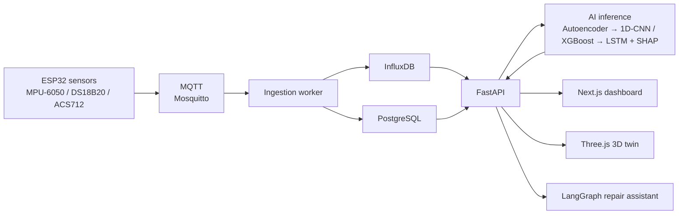

# Smart Motor Monitoring & Predictive Maintenance System

Monorepo for a graduation project that streams ESP32 motor sensor data over MQTT into FastAPI/InfluxDB/PostgreSQL, runs predictive AI with SHAP explanations, and presents a Next.js dashboard with a Three.js 3D digital twin and a LangGraph repair assistant.

Built by a team of 6, **layer by layer**.

## Architecture

## Layers & status

| Layer | Owner | FRs | Status |
|-------|-------|-----|--------|
| Layer 1 — Hardware & Edge | _TBD_ | FR-01 | **ACTIVE** |
| Layer 2 — Telemetry Ingestion & Storage | _TBD_ | FR-01, FR-06, FR-07 | NOT STARTED |
| Layer 3 — Predictive AI & Engines | _TBD_ | FR-02, FR-05, FR-06, FR-08 | NOT STARTED |
| Layer 4 — 3D Twin, Dashboard & Agent | _TBD_ | FR-03, FR-04, FR-05, FR-06, FR-07, FR-08 | NOT STARTED |

## Build rule

Work is **strictly sequential**. A layer may start only after the previous layer’s **handover gate** is passed. No skipping ahead into implementation of a later layer.

## Team roles

| # | Role | Focus | Assignee |
|---|------|-------|----------|
| 1 | Hardware | Edge / ESP32 sensing & MQTT publish | _TBD_ |
| 2A | AI — Predictive ML | Anomaly, fault classification, RUL | _TBD_ |
| 2B | AI — XAI & Agent | SHAP explanations, LangGraph repair assistant | _TBD_ |
| 3 | Backend | FastAPI, ingestion, InfluxDB, PostgreSQL | _TBD_ |
| 4A | Frontend — 3D Twin | Three.js digital twin | _TBD_ |
| 4B | Frontend — Dashboard | Next.js live dashboard & UX | _TBD_ |

## Folder map

| Path | Purpose |
|------|---------|
| `edge/` | Layer 1 — ESP32 firmware & fault injection |
| `backend/` | Layer 2 + Layer 3 serving — FastAPI, ingestion, DB |
| `ml/` | Layer 3 — models, preprocessing, SHAP, agent |
| `frontend/` | Layer 4 — Next.js dashboard & Three.js twin |
| `docs/` | Architecture, requirements, contracts, wiring, seminar |
| `simulator/` | Optional fake ESP32 MQTT publisher (later) |
| `scripts/` | Shared utility scripts (later) |

## Contributing & process

- [CONTRIBUTING.md](CONTRIBUTING.md) — branch model, commits, PRs, contracts, what not to commit, how to close a gate
- [docs/branching.md](docs/branching.md) — branch diagram and exact git commands
- [docs/gates/](docs/gates/) — handover gate checklists (Gate 1–4) with evidence lines
- [docs/safety.md](docs/safety.md) — 220V AC test bench safety checklist (required before powered tests)
- [CHANGELOG.md](CHANGELOG.md) — Keep a Changelog entries per layer tag

## Quick start

> **TODO** — Fill in once Layer 1 handover is complete and Docker / env setup is documented.

1. Clone this repo
2. Copy `.env.example` → `.env` and fill values
3. Start infrastructure: `docker compose up` _(placeholder)_
4. Follow layer READMEs in order: `edge` → `backend` → `ml` → `frontend`
