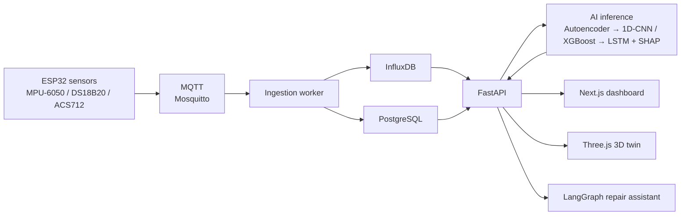

# Architecture

High-level design for the Smart Motor Monitoring & Predictive Maintenance System. Implementation is deferred until each layer’s handover gate; this document describes intended boundaries only.

## Layers

### Layer 1 — Hardware & Edge

ESP32 reads MPU-6050 (vibration), DS18B20 (temperature), and ACS712 (current), calibrates samples, and publishes JSON telemetry to Mosquitto over MQTT. Fault-injection fixtures produce labeled data for ML.

### Layer 2 — Telemetry Ingestion & Storage

An ingestion worker subscribes to MQTT, writes time-series points to InfluxDB, and persists relational/auth/audit data in PostgreSQL. FastAPI exposes APIs for clients and later for inference results, reports, and RBAC.

### Layer 3 — Predictive AI & Engines

Offline training and online inference: Autoencoder (anomaly) → 1D-CNN / XGBoost (fault type) → LSTM (RUL), with SHAP explanations and a LangGraph repair assistant. Artifacts are versioned; contracts define inference output JSON.

### Layer 4 — 3D Twin, Dashboard & Agent

Next.js dashboard consumes REST/WebSockets for live health score, ROI, and alerts. Three.js renders a motor digital twin. UI surfaces SHAP insights and repair steps from the agent.

## Diagram

## Contracts

- Telemetry: `docs/contracts/mqtt-telemetry.schema.json` — topic `motors/{motor_id}/telemetry`
- Inference: `docs/contracts/inference-output.schema.json`
- HTTP API: `docs/contracts/openapi.yaml` (placeholder until Layer 2)

## Build rule

Layers advance strictly in order. A layer starts only after the previous layer’s handover gate is passed (see layer READMEs under `edge/`, `backend/`, `ml/`, `frontend/`).
