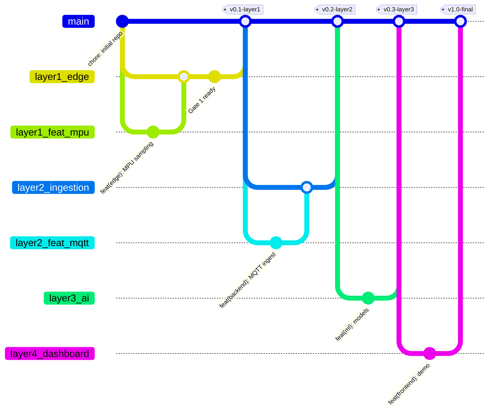

# Branching & tags

How `main`, layer branches, feature branches, merges, and release tags relate for this project.

## Picture



ASCII (same idea):

```
main ──●────────────────────────●──────────●──────────●──────────●──
       │                        │          │          │          │
       │                   v0.1-layer1  v0.2-layer2 v0.3-layer3 v1.0-final
       │                        ▲          ▲          ▲          ▲
       └── layer1/edge ─────────┘          │          │          │
            └── layer1/feat-… ─┘           │          │          │
                                           │          │          │
              layer2/ingestion ────────────┘          │          │
                   └── layer2/feat-… ─┘               │          │
                                                      │          │
                         layer3/ai ───────────────────┘          │
                                                                 │
                            layer4/dashboard ────────────────────┘
```

**Tags**

| Tag | Gate |
|-----|------|
| `v0.1-layer1` | Gate 1 — Edge |
| `v0.2-layer2` | Gate 2 — Ingestion |
| `v0.3-layer3` | Gate 3 — AI |
| `v1.0-final` | Gate 4 — Final demo |

## Exact commands

### Create a feature branch (from the active layer branch)

```bash
git checkout layer1/edge
git pull origin layer1/edge
git checkout -b layer1/feat-short-name
# ... work, commit ...
git push -u origin layer1/feat-short-name
```

### Open a PR

Open a PR on GitHub/GitLab: **base** = active layer branch (e.g. `layer1/edge`), **compare** = your feature branch. Fill the PR template, link the issue, request one reviewer (preferably from the next layer).

```bash
# optional, if gh is installed:
gh pr create --base layer1/edge --head layer1/feat-short-name --title "feat(edge): short name" --body "..."
```

### Merge a layer branch into `main` (after the gate passes)

Do this only when the gate checklist is complete. Prefer a PR into `main` (protected branch), then:

```bash
git checkout main
git pull origin main
git merge layer1/edge
# or merge via the approved PR on the host
git push origin main
```

### Tag a passed gate

```bash
git checkout main
git tag -a v0.1-layer1 -m "Gate 1 passed"
git push origin v0.1-layer1
```

Update `CHANGELOG.md` in the same gate close-out.

### Start the next layer branch from `main`

```bash
git checkout main
git pull origin main
git checkout -b layer2/ingestion
git push -u origin layer2/ingestion
```

Repeat the pattern for `layer3/ai` and `layer4/dashboard` after each prior tag.
